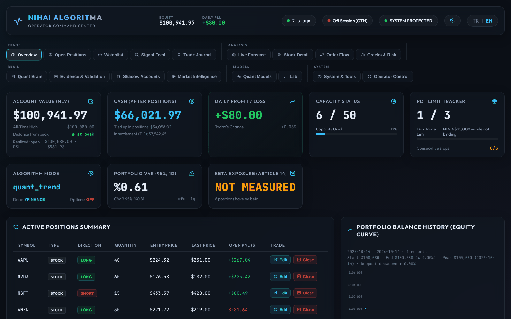
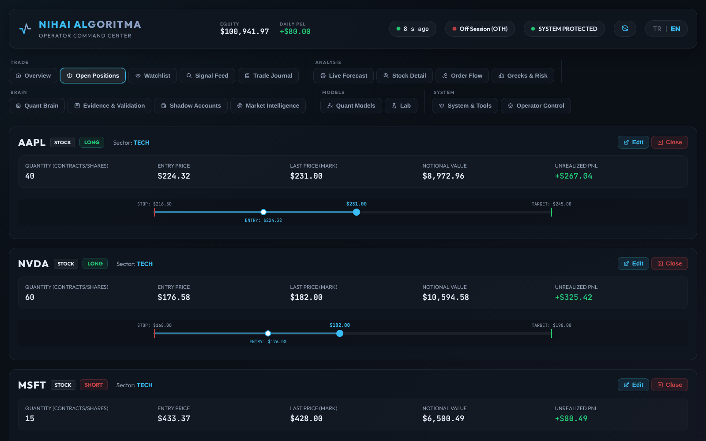
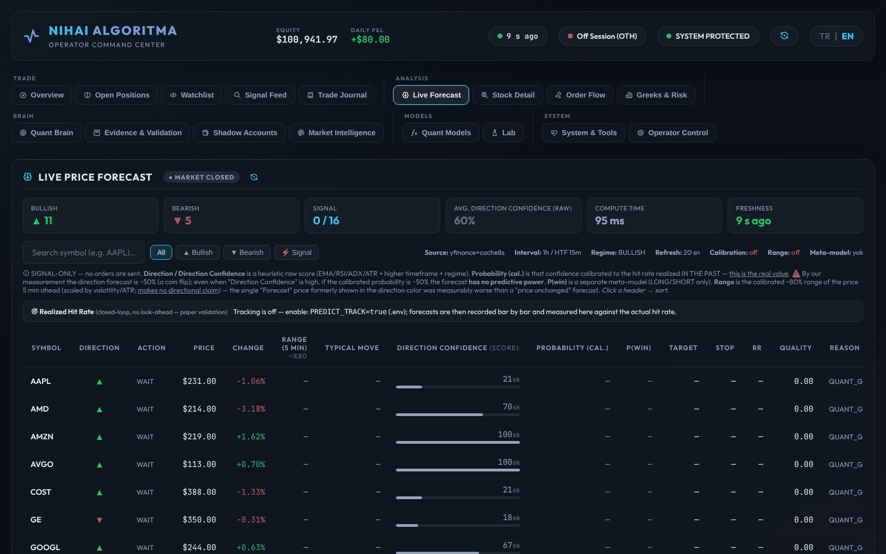
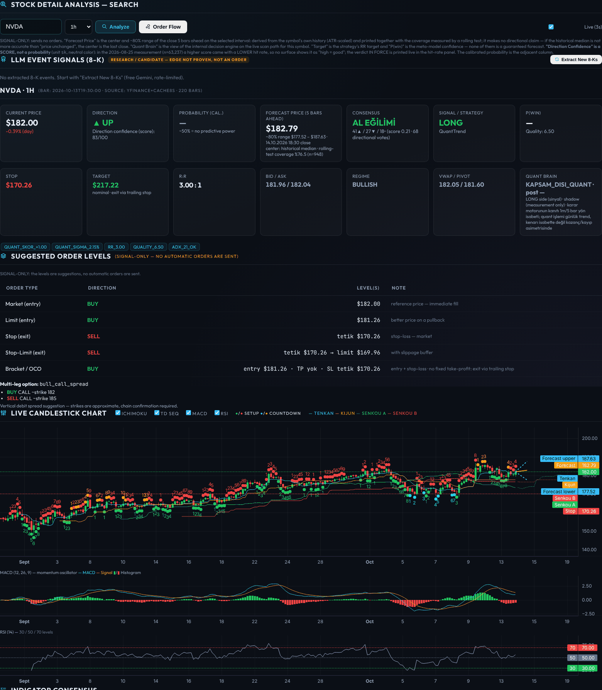
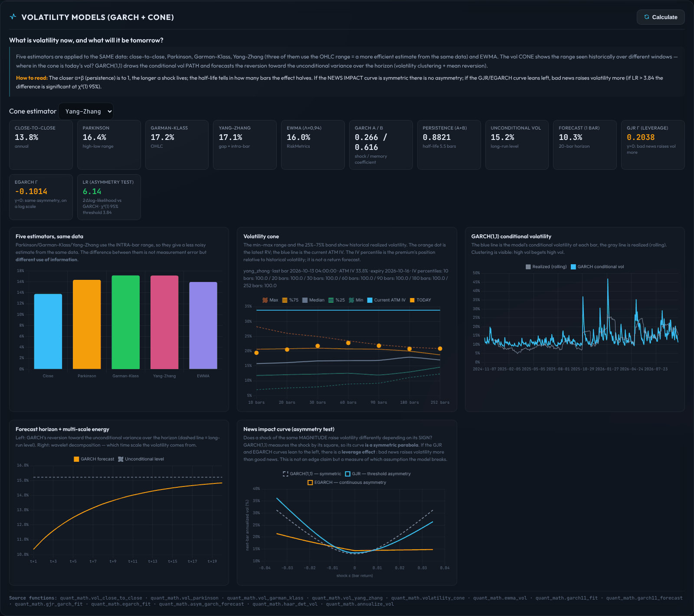
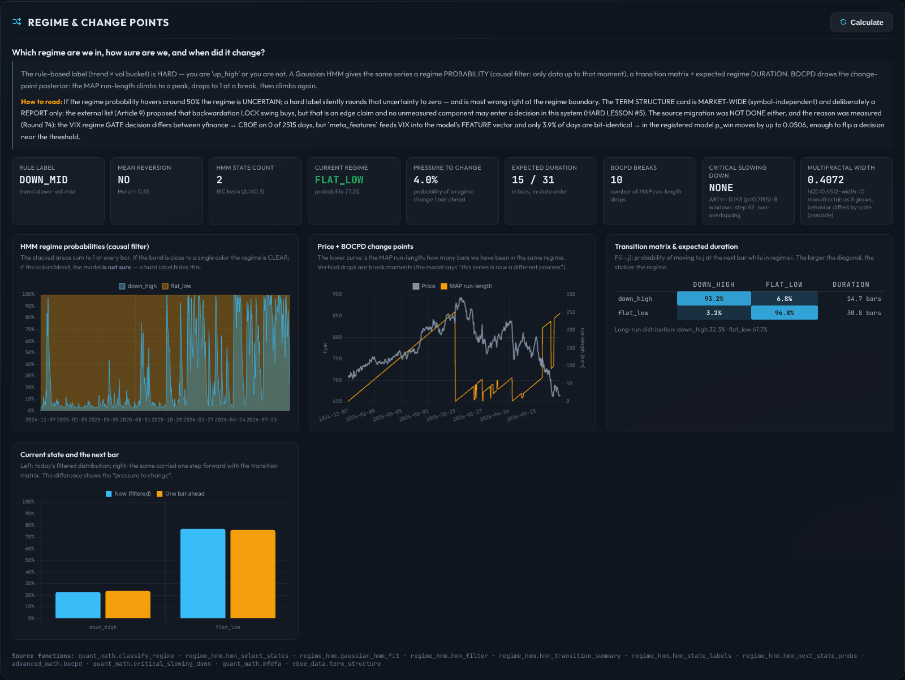
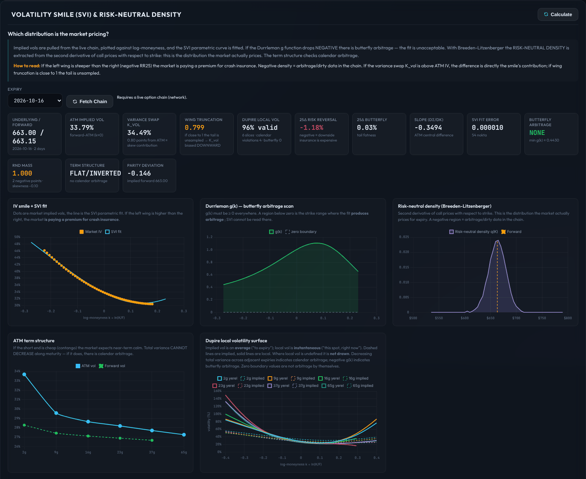
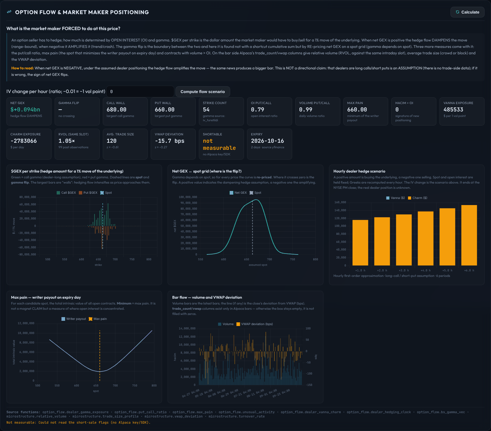
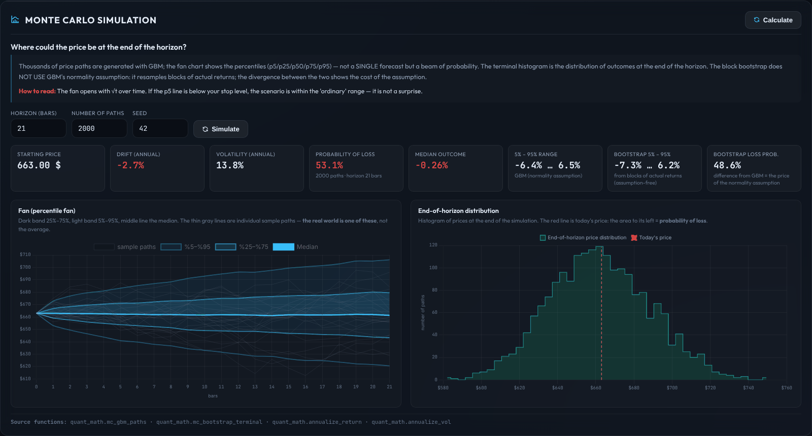

# Nihai Algoritma — Hisse & Opsiyon Sinyal Sistemi

**English** · [Türkçe](#türkçe-belge)



## Overview

**Nihai Algoritma** ("Final Algorithm") is a signal-only research and monitoring system for US equities and
options. It scans a watchlist on closed bars, scores every decision against a written rule set, opens and manages
**virtual (paper) positions**, and reports everything through a web dashboard, a terminal dashboard and Telegram.
**It never sends orders to a broker.** There is no broker client and no order manager in the code; this is a
deliberate design choice, not a missing feature.

The rule set comes from a 53-article architecture document (`Nihai_Algoritma_Mimarisi_Hisse_Opsiyon_v2_2.pdf`,
six sections). The Turkish part of this README has a table that maps each article to the module that implements it.

> I built this project solely for myself and I am still working on it; it has known shortcomings and bugs. Code
> comments, reports and most of the documentation are in Turkish (my native language). The web dashboard has an
> English mode (**TR | EN** switch in the header, or `?lang=en`). AI models were used while building it.

### Design principles

- **Signal-only.** The system decides, logs and alerts; a human places any real trade. "Orders" in the dashboard
  are suggested levels.
- **No look-ahead.** Every signal and feature uses only data up to the decision bar. In backtests a decision made on
  bar *i* is filled at the open of bar *i+1*.
- **Evidence before claims.** A candidate edge must pass purged cross-validation, both time and symbol splits, a
  point-in-time universe, a deflated Sharpe ratio and a one-bar execution-lag test before anyone may call it real.
  Most candidates failed, and the failures are documented.
- **Shadow first.** New models and AI components run in shadow or advisory mode. They log what they would have done,
  and a promotion gate decides from the logs whether they may ever affect a decision.
- **Fail soft, never fake a number.** When a value cannot be measured, the dashboard shows "—" or "not measured"
  instead of a default that looks like a measurement.

## Screenshots

The images below come from the English mode of the dashboard (`?lang=en`). They were taken in a sandbox with no
market-data access, so the prices are **synthetic**, and the six open positions were opened through the
dashboard's manual-order endpoint. Some free text produced by the backend (indicator comments, AI notes) is still
in Turkish.

| | |
|---|---|
|  |  |
| **Open Positions:** every virtual position with entry, last price, stop and target on one bar, plus edit and close controls. | **Live Forecast:** direction, confidence score, calibrated probability and the ~80% price range for each watchlist symbol, with the hit rate measured on resolved forecasts. |

**Stock Detail:** a single-symbol view with the current signal, stop/target and R:R, suggested order levels, a live
candlestick chart (Ichimoku, TD Sequential, forecast band, MACD, RSI) and an indicator consensus table.



**Quant Models:** 19 model panels. Each one states the question it answers, explains how to read it and lists the
source functions. Four examples:

| | |
|---|---|
|  |  |
| **Volatility:** five estimators on the same data, volatility cone, GARCH(1,1) conditional volatility and a GJR/EGARCH news-impact (asymmetry) test. | **Regimes:** Gaussian HMM regime probabilities (causal filter), BOCPD change points, transition matrix and expected regime duration. |
|  |  |
| **Volatility smile:** SVI fit, Durrleman butterfly-arbitrage check, risk-neutral density, ATM term structure and a Dupire local-volatility surface. | **Option flow:** dealer gamma exposure by strike, net GEX across spot, max pain and an hourly dealer-hedge scenario. |



**Monte Carlo:** a GBM fan chart and the end-of-horizon distribution, set beside a block bootstrap of actual
returns. The gap between the two shows what the normality assumption costs.

## How it works

```
 data provider ──▶ strategy ──▶ guards ──▶ risk sizing ──▶ virtual position ──▶ logs · dashboard · Telegram
 (yfinance /       (signal on    (session,   (fixed risk,     (stop, trailing
  Alpaca hub)       closed bar)   events,     caps, Reg T,     stop, time stop,
                                  halts,      PDT, kill        end-of-day flat)
                                  quotes)     switch)
```

1. **Data.** `nihai/data` returns OHLCV bars and quotes behind one interface, with automatic failover and a short
   cache. yfinance works without an API key. With Alpaca, a local hub process (`nihai.data.hub_server`, port 8799)
   holds the single upstream connection and streaming subscription, and other processes read from it over HTTP.
   Bars are restricted to the regular session, split-adjusted and aligned to the session open, so every provider
   produces the same bars.
2. **Signal.** `nihai/signals/strategy.py` turns bars into ENTER / EXIT / WAIT with a reason list, a quality score and
   structural stop and target levels. The current price is re-anchored to the live quote before the R:R check.
3. **Guards.** Session hours, cooldowns, the earnings and macro event calendar, halt/LULD heuristics, quote health,
   SSR and short-borrow flags, and corporate actions. Each guard can stop a signal and records its reason code.
4. **Risk.** `nihai/risk` sizes positions by fixed risk per trade and caps them by position, sector, portfolio heat,
   net direction, Reg T buying power and option Greek budgets. It also tracks pattern-day-trader limits and runs a
   kill switch.
5. **Positions.** `PositionManager` manages stops, trailing stops, time stops and end-of-session flattening. The live
   loop and the backtester share this class, so paper results and backtests follow the same rules.
6. **Reporting.** Every decision, including every skipped one, goes to a daily decision log. Closed trades get a
   post-mortem. Accepted signals go to Telegram and into a hash-chained audit log.

In normal operation two processes run: the data hub (8799) and the scanner with the dashboard
(`nihai.execution.main --serve-web`, 8765), which also hosts the forecast service and the shadow accounts. Windows
scripts (`proje-ac.ps1`, `proje-kapat.ps1`, the watchdogs) start, stop and supervise them.

### Strategies

There are 15 strategy modes (`ACTIVE_STRATEGY` or `--strategy`). The default is `quant_trend`.

| Mode | Idea |
|---|---|
| `quant_trend` | Time-series momentum: the average sign of 21/63/252-day returns, with stops scaled to EWMA volatility and a trailing exit instead of a fixed target. Uses daily bars. |
| `event_breakout` | EMA20/50 trend plus a 20-bar breakout. |
| `donchian`, `squeeze`, `vol_breakout`, `trend_pullback` | Channel breakouts, breakouts after volatility compression, and pullbacks in a trend. |
| `macd`, `mean_reversion`, `rsi_divergence` | Momentum crossovers and reversal setups. |
| `pead`, `insider`, `sentiment`, `llm_event` | Event-driven signals: post-earnings drift, SEC insider filings, social sentiment and 8-K filings read by a language model. They need external data. |
| `ensemble`, `confluence` | Meta-modes. `ensemble` takes the first detector that fires; `confluence` requires agreement between several independent detectors. |

### Dashboard tour

The dashboard has 17 tabs in five groups.

- **Trade:** Overview, Open Positions, Watchlist, Signal Feed (with a decision funnel that shows why candidates were
  rejected), Trade Journal.
- **Analysis:** Live Forecast, Stock Detail, Order Flow (footprint, volume profile, large trades, net gamma exposure;
  a liquidity heatmap for crypto), Greeks & Risk.
- **Brain:** Quant Brain (the AI layer's state, learning, memory and model cards), Evidence & Validation (forward
  test, gate simulation, tear sheet), Shadow Accounts, Market Intelligence.
- **Models:** Quant Models (19 panels: tail risk, volatility, regimes, Monte Carlo, Black-Scholes and Greeks,
  smile, portfolio allocation, statistical arbitrage, microstructure, optimal liquidation, Kelly sizing, option flow,
  yield curve, macro regime, company fundamentals, model drift, DCC/FIGARCH/wavelets, topological data analysis,
  dispersion), Lab (backtest and walk-forward jobs from the browser).
- **System:** System & Tools (API budget, stream health, data files, decision bridges), Operator Control (close or
  flatten positions, edit stops and targets, manual orders, settings, kill-switch reset).

Setting `WEB_TOKEN` protects every endpoint that changes state. The server binds to localhost.

### AI layer

`nihai/ai` is a large, mostly report-only package:

- A quant math library: GARCH and asymmetric GARCH, HAR-RV, copulas, EVT, implied volatility, SVI/SSVI/SABR,
  Dupire local volatility, HMM regimes, BOCPD, microstructure estimators (Roll, Corwin-Schultz, Kyle λ, VPIN, PIN),
  random-matrix denoising, HRP/NCO/Black-Litterman/CVaR and CDaR portfolios, statistical arbitrage, fundamentals
  scores from SEC XBRL data, and more.
- A Bayesian decision engine (`decision`) with calibration loops, episodic memory and an online expert combiner.
  It is connected to the live scan through `AI_LIVE_MODE`: `off` (default), `advise` (its opinion is written to the
  signal reasons and the Telegram alert) or `enforce` (it may only veto or shrink a signal; it can never create or
  reverse one).
- A neural capacity ladder from a 187k-parameter MLP to a 2.0-billion-parameter sparse mixture-of-experts
  transformer. The live shadow model logs a p(win) next to each candidate and never touches the decision.
  **Trained weights are not included.**
- Shadow accounts: six separate virtual accounts, one per decision mechanism plus a control account, so each
  mechanism can be judged on its own live P&L.

### Research and what it found

`research/` holds the offline experiments: meta-labeling, purged and embargoed K-fold CV, a deflated Sharpe ratio, an
edge lab that keeps a ledger of every candidate family (so the multiple-testing penalty grows with the search), runs
over 14 market groups, and two pre-registered forward tests.

The project records its negative results:

- Survivorship bias created edges. Post-earnings drift had a profit factor of 1.57 on today's Nasdaq-100 and 1.05 on
  a point-in-time S&P 500.
- Meta-labeling showed no edge on a point-in-time universe (out-of-sample AUC 0.51–0.52).
- In six separate families, an edge that passed every other gate disappeared once execution was delayed by one bar.
- Across the 14 market groups, the one skill that held up was **volatility forecasting**. Direction models did not
  beat their baselines after costs.
- `quant_trend` beat the earlier technical strategies in the same engine, including on data it had never seen, but
  it did **not** beat buy-and-hold.

The reports do not claim a tradable edge. The lessons are collected in `CLAUDE.md` (section "ACI DERSLER") and
`docs/EDGE_FINDINGS.md`. The dated round reports in `docs/` record each change with its measurements.

### What is in the repository

| Area | What it does |
|---|---|
| Live scanner (`nihai/execution`) | Scans symbols on closed bars, applies the guards, then opens and manages virtual positions. Also contains the backtester, the replay tool, the forecast service and the shadow accounts. |
| Risk engine (`nihai/risk`) | Position sizing, portfolio and sector caps, Reg T buying power, PDT tracking, kill switch, option analysis and Greek limits. |
| Signals (`nihai/signals`) | Strategies, the quant trend core, market breadth, meta-labeling features and the meta gate. |
| Backtesting | Bar-by-bar engine with Monte Carlo, walk-forward, portfolio mode, a synthetic option mode and an isolated replay of the live pipeline. |
| Dashboard (`nihai/web`) | FastAPI app with the 17 tabs described above and an English translation layer (`pano_en.json`, `pano_i18n.js`). |
| Notifications (`nihai/notifier`) | Telegram alerts and commands (`/status`, `/watchlist`, `/add`, `/remove`, `/dur` to pause signals, `/devam` to resume, `/beyin` for the AI scorecard), a daily health summary and a dead-man's switch. |
| AI layer (`nihai/ai`) | See above. Runs in shadow or advisory mode by default. |
| Research lab (`research/`) | Offline experiments and evidence gates. |
| Data | yfinance out of the box. Optional: Alpaca (REST and streaming through the hub), SEC EDGAR, FRED, CBOE, DoltHub options, Binance/Bybit/OKX public data for crypto order flow, and Ken French factors. |
| Tests | About 5,500 offline tests; network access is blocked while they run. |

### Quick start

Requires Python 3.11 or newer (developed on Windows with Python 3.12).

```bash
git clone https://github.com/xakii-112/Trade-Algorithma.git
cd Trade-Algorithma
python -m venv .venv
.venv\Scripts\activate                        # Linux/macOS: source .venv/bin/activate
pip install -r requirements.txt
copy .env.example .env                        # Linux/macOS: cp .env.example .env
python -m nihai.execution.main --once         # one scan, then exit
python -m nihai.execution.main --serve-web    # live loop + dashboard at http://127.0.0.1:8765
```

Open `http://127.0.0.1:8765/?lang=en` for the English dashboard. The default yfinance provider needs no API keys.
`.env.example` documents every setting. The most important ones:

| Setting | Meaning |
|---|---|
| `ACTIVE_STRATEGY` | Strategy mode (default `quant_trend`). |
| `DATA_PROVIDER` | `yfinance` (default), `alpaca`, `alpaca_stream` or `hub`. |
| `OPTION_MODE` | `stock` (default), `option` or `both`. |
| `INITIAL_EQUITY` | Starting balance of the virtual account. |
| `TELEGRAM_BOT_TOKEN`, `TELEGRAM_CHAT_ID` | Optional alerts; leave empty to run silently. |
| `WEB_TOKEN` | Optional token for the dashboard's state-changing endpoints. |
| `META_GATE`, `AI_LIVE_MODE`, `SHADOW_BRIDGE` | Whether a shadow component only reports or may act: `META_GATE` is `false`/`shadow`/`true`; the other two are `off`/`advise`/`enforce`. All three default to not acting. |

Other useful commands:

```bash
python -m nihai.execution.backtest --symbol AAPL MSFT SPY --portfolio --interval 1d --period 2y
python -m nihai.execution.backtest --symbol AAPL --walk-forward --is-bars 180 --oos-bars 60
python -m nihai.execution.replay --symbols AAPL,MSFT --from 2026-09-11 --to 2026-09-11 --out <empty dir>
python -m nihai.execution.auto_screener       # rank the universe by backtest and update the watchlist
python -m nihai.notifier.daily_summary        # daily system-health summary (--send for Telegram)
python -m research.forward_harness            # resolve and score live forecasts
```

To run the tests and quality checks:

```bash
pip install -r requirements-dev.txt
pytest
ruff check .
mypy .
```

### Not included

Secrets (`.env`), runtime data and logs (`data/`, `logs/`), market data caches, datasets and trained model weights
are not part of the repository. A fresh clone starts with an empty virtual portfolio. Some research commands expect
datasets or caches that you must build first.

### Known limitations

- Free data is limited. yfinance has no delisted symbols, so backtests on it carry survivorship bias. The free Alpaca
  IEX feed sees only about 3% of consolidated volume.
- The option backtest prices synthetic contracts with Black-Scholes, not a historical option chain.
- Order-flow sides for US stocks are estimated with the tick rule, because US exchanges do not report the aggressor
  side. There is no free level-2 data, so the stock liquidity heatmap is not available.
- Much of the operations tooling is Windows PowerShell.
- Backend free text and most documentation are in Turkish.

### Repository layout

```
nihai/      production package: data, signals, risk, execution, web, notifier, ai
research/   offline experiments, model training, edge lab
tests/      offline test suite
docs/       dated round reports (in Turkish) and screenshots
tools/      maintenance scripts
*.ps1       Windows operations scripts (watchdogs, scheduled tasks)
```

### License and disclaimer

All rights reserved; this repository is not open source. See [LICENSE](LICENSE). This is a research system and
nothing in it is investment advice.

---

## Türkçe belge

> **Mod:** Sinyal-only / Raporlayıcı. Bu sistem **emir göndermez**; sadece tarar, kararı puanlar, log + bildirim üretir.
> Mimari PDF spec: `Nihai_Algoritma_Mimarisi_Hisse_Opsiyon_v2_2.pdf` (53 madde, 6 bölüm).

## Mimari Özet

```
                        ┌─────────────────────────┐
                        │   main.py (orkestra)    │
                        └────────────┬────────────┘
                                     │
   ┌──────────────┬──────────────────┼──────────────────┬──────────────┐
   ▼              ▼                  ▼                  ▼              ▼
calendar      data_provider     strategy           risk_manager    safety
(RTH, DST)    (yfinance impl,   (event-based,      (Madde 2,9,     (devre
              Madde 34/45)      Madde 1/16/17/18)  10,13,14,27)   kesici)
                                     │                  │
                                     └───────┬──────────┘
                                             ▼
                                    options_analyzer
                                    (Greekler, IV, Madde 21/27/28/29)
                                             │
                                             ▼
                                       signal_engine
                                       (Madde 19/37/38 loglar)
                                             │
                ┌────────────────────────────┼────────────────────────────┐
                ▼                            ▼                            ▼
        terminal_dashboard          web_dashboard                 telegram_bot
        (rich, Madde 39)            (FastAPI)                     (Madde 47)
```

## Madde Eşlemesi (Hangi Modülde Hangi PDF Kuralı?)

| Madde | Konu | Modül |
|------:|------|-------|
| 1 | Olay-bazlı giriş | `strategy.detect_event` |
| 2 | Sabit risk | `risk_manager.size_long_option / size_stock` |
| 3 | Look-ahead koruması | `data_provider.YFinanceProvider.get_bars` · `alpaca_provider` · `alpaca_stream_provider` (oluşan son bar atılır; akışın 1d bugün barı `market_calendar.kapanmis_gunluk`) |
| 7 | Re-entry cooldown | `state.StateStore.cooldown_active` |
| 8 | Min R:R | `strategy.compute_rr` + `CONFIG.strategy.min_rr_ratio` |
| 9 | Adaptif risk | `RiskManager._current_risk_pct` |
| 10 | Günlük max kayıp + PDT | `RiskManager.daily_loss_breach / pdt_blocks_day_trade` |
| 11 | Zaman-bazlı stop | `CONFIG.risk.time_stop_minutes` (açık DAKİKA, Tur-39; `time_stop_bars` yalnız yedek) → `PositionManager.check_exit` |
| 12 | Korelasyon/kümelenme | `RiskManager.portfolio_caps_breach` (sektör) |
| 13 | Reg T / FINRA | `CONFIG.regulation` + `RiskManager._magnitude_cap_units` (alım gücü adayı REDDETMEZ, küçültür; toplam brüt tavanı Tur-89) |
| 14 | Portföy maruziyet tavanları | `RiskManager.portfolio_caps_breach` |
| 16 | Piyasa + IV rejimi | `strategy.regime_filter`, `options_analyzer.iv_rank` |
| 17 | IV crush / ATR patlaması | `strategy.volatility_explosion_filter` |
| 18 | Sinyal kalite skoru | `strategy.signal_quality_score` |
| 19 | Karar logu | `signal_engine.log_decision / log_signal` |
| 20 | Kill-switch | `state.StateStore.record_trade_pnl` |
| 21 | Opsiyon likidite | `options_analyzer.filter_liquid_chain` |
| 22 | RTH / oturum | `market_calendar.can_enter_new_position` |
| 23 | T+1, Reg T, FINRA, PDT | `config.Regulation` |
| 27 | Net Greek limitleri | `options_analyzer.PortfolioGreeks` + `RiskManager.greek_caps_breach` |
| 28 | Vade / DTE / pin | `options_analyzer.days_to_expiry / is_pin_risk` |
| 29 | Amerikan/Avrupa, 1256 | `options_analyzer.settlement_style` (+ `state.wash_sale_check` §1256 muafiyeti) |
| 32 | Per-contract fees | `risk_manager.OPTION_FEES` |
| 34 | Veri sağlığı | `DataProvider.is_quote_healthy` |
| 36 | Heartbeat (seans-farkındalı) | `main.run_loop` + `telegram_bot.heartbeat` |
| 37 | Karar günlüğü dosyası | `signal_engine.log_decision` → `logs/decision_log_YYYY_MM_DD.txt` |
| 38 | Trade post-mortem | `signal_engine.log_trade_postmortem` → `logs/trade_log.txt` |
| 39 | Boşta/Pozisyonda pano | `notifier/terminal_dashboard.py`, `web_dashboard.py` |
| 41 | Başlangıç mutabakatı | `main.startup_reconciliation` |
| 42 | Fat-finger devre kesici | `safety.CircuitBreaker` |
| 43 | Timezone / DST | `market_calendar` (ET + `zoneinfo`); zamanlayıcı tetiği `local_session_window()` ile türetilir |
| 44 | Sırlar env'de + web auth | `.env` + `config`; `web_dashboard._auth_ok` (sabit-zamanlı + kaba-kuvvet kilidi) |
| 45 | Veri yedekliliği | `data_provider.DataProvider` (soyut interface) |
| 47 | Operatör yönetişimi | `telegram_bot.notify_alert` + web `/health` |
| 4 | Gap simülasyonu | `position_manager.PositionManager.check_exit` (GAP_STOP) |
| 5,15,51,52 | Backtest / Monte Carlo | `backtest.py` |
| 6 | Disiplinli çıkış | `position_manager.PositionManager._close` |
| 38 | Otomatik post-mortem | `position_manager._close` → `signal_engine.log_trade_postmortem` |
| 2,16,17,21,27,28 | Opsiyon end-to-end | `option_strategy.select_option_contract` |
| 5 | 1m granüler stop | `position_manager.update_all_with_1m_bars` |
| 16 | IV Rank persistent cache | `iv_history.append_iv_today / get_iv_rank` |
| 17 | IV crush filtresi | `event_calendar.iv_crush_guard_for_option` |
| 26 | Olay/bilanço takvimi | `event_calendar.get_company_events / event_guard` |
| 36 | Sofistike heartbeat | `main.run_loop` (seans geçişi + detaylı durum) |
| 45 | Otomatik data failover | `data_provider.FailoverProvider` (auto factory) |
| 52 | Backtest/Paper/Live kapısı | `gate.py` (CLI: --check, --parity) |
| 50 | Realized slippage | `position_manager.SlippageModel` + `TradeRecord.realized_slippage` |
| 12 | Sembol-başı kümelenme tavanı | `RiskManager.portfolio_caps_breach` (aynı sembol+yön ≤ `max_signals_per_symbol_open`) |
| 14 | Net yönsel maruziyet tavanı | `RiskManager.portfolio_caps_breach` (signed notional / equity) |
| 16 | Canlı IV Rank → sinyal kalitesi | `options_analyzer.estimate_atm_iv` → `iv_history.get_iv_rank` (main.scan_symbol) |
| 24 | Halt / LULD koruması | `market_structure.halt_or_luld_guard` |
| 25 | Kurumsal aksiyon (split) + ex-temettü erken kullanım | `event_calendar.corporate_action_guard` · `options_analyzer.early_exercise_risk` (`EXDIV_GUARD`) |
| 30 | SSR (Reg SHO Rule 201) farkındalığı | `market_structure.ssr_short_guard` (SHORT sinyallerinde) |
| 53 | Wash-sale izleme (çapraz + §1256 muaf) | `state.register_close_for_wash_sale` / `wash_sale_check` |
| 23 | T+1 takas / good-faith izleme | `state.add_unsettled_proceeds` / `settle_matured` / `good_faith_warning` |
| 48 | REST cache + hız bütçesi/fren | `data_provider.CachingProvider` · `observability.RateBudget` (+ pano `/metrics`) |
| 42 | Devre kesici dur/sürdür (operatör) | Telegram `/dur` · `/devam` (`main.py` `tg_handlers` → `CircuitBreaker.trip/reset`) |
| — | Eşzamanlılık (web↔döngü yarış) | `concurrency.PORTFOLIO_LOCK` |
| — | Canlı equity eğrisi | `main.append_equity_point` → `data/equity_curve.csv` |

## Dizin Yapısı

Kod `nihai/` (canlı/production sistem) ve `research/` (offline deney + araç) olarak ayrılmıştır:

```
nihai/
  config.py, universe.py     # paylaşılan konfig + sembol evrenleri (BASKET)
  data/                      # sağlayıcılar, hub, takvim, IV/olay geçmişi
  signals/                   # strategy, signal_engine, meta_*, market_regime
  risk/                      # risk_manager, position_manager, safety, options
  execution/                 # main, backtest, auto_screener, state, watchlist, prediction_tracker
  web/                       # web_dashboard (+ .html)
  notifier/                  # terminal + telegram
research/                    # ablation, bench, *_test, exit_grid, xsect, pead_*, build_*/train_* (manuel araçlar)
tests/                       # offline test paketi
docs/                        # tur raporları, spec'ler, denetim/entegrasyon belgeleri (tarihli)
CLAUDE.md                    # proje asistanı yönergesi + ACI DERSLER (institutional knowledge)
CHANGELOG.md                 # sürüm günlüğü
OPTIMIZASYON_LOG.md          # tur-tur hata/optimizasyon kaydı — ölçüm ve denklik kanıtları
```

**Çalıştırma** (modül formu — kök dizinden):
```powershell
python -m nihai.execution.main --serve-web      # canlı sistem
python -m nihai.execution.backtest --symbol AAPL --interval 1d --period 2y
python -m research.xsect --universe nasdaq100    # araştırma scripti
```
`.ps1` launcher'lar (`run.ps1` / `run-hub.ps1` / `run-duo.ps1`) bu modül yollarını otomatik kullanır.

## Kurulum

```bash
# Python 3.11+ önerilir
cd NihaiAlgoritma
python -m venv .venv
.venv\Scripts\activate      # Windows
pip install -r requirements.txt

# Çevre değişkenlerini ayarla
copy .env.example .env
# .env içini doldur (Telegram opsiyonel; boş bırakırsan sessiz çalışır)
```

## Kullanım

```powershell
# Tek tur tara, çık
python -m nihai.execution.main --once

# Canlı sinyal modu (terminal panosu)
python -m nihai.execution.main

# Canlı + web dashboard (http://127.0.0.1:8765)
python -m nihai.execution.main --serve-web

# Acil: tüm açık (sanal) pozisyonları kapat (Madde 47) — ana süreç ÇALIŞMIYORKEN. Çalışırken bu komut
# reddedilir (ayrı süreç diskteki kopyayı kapatır, döngü geri yazardı): pano → Operatör Kontrol → Flatten All.
python -m nihai.execution.main --flatten
```

### Dinamik watchlist & oto-tarama
Sistem hangi hisseleri izleyeceğini **kendisi seçebilir**. config `WATCHLIST` artık
yalnızca başlangıç tohumu; asıl canlı liste `data/watchlist.json`'da tutulur ve
oto-tarayıcı tarafından güncellenir.

```powershell
# Bağımsız tek tarama: evreni backtest'le, watchlist'i güncelle, çık
python -m nihai.execution.auto_screener

# Başlangıçta senkron tara, sonra canlı moda geç
python -m nihai.execution.main --serve-web --screen-now
```

`.env` ile ayarlanır (tümü opsiyonel, makul varsayılanlar var):

| Mod | Ayar | Davranış |
|-----|------|----------|
| Top-N | `AUTO_SCREEN_TOP_N=20` | Evrenin en iyi 20'si (expectancy/sharpe'a göre) |
| HEPSİ | `AUTO_SCREEN_TOP_N=0` | Tüm evren (backtest sıralaması atlanır) |
| İki-katman | `DUAL_TIER_ENABLED=true` | En iyi N → TradingView, kalanı → yfinance, **paralel** |

**İki-katman**: en iyi `FOCUSED_TOP_N` sembol "odak" katmanında (`FOCUSED_PROVIDER`,
örn. TradingView), kalan tüm evren "geniş" katmanında (`BROAD_PROVIDER`, örn.
yfinance) ayrı thread'lerde paralel taranır. Ortak portföy tek kilitle korunur.

**Manuel kontrol (pin/block)**: web panosundaki "Watchlist Yönetimi" kartından veya
API ile operatör override eder — eklenen sembol pinlenir (oto-tarama silemez),
çıkarılan engellenir (oto-tarama geri ekleyemez).
```powershell
# CLI (sunucu gerekmez)
python -m nihai.execution.watchlist                    # listele (+ pin/block/son tarama)
python -m nihai.execution.watchlist add NVDA           # pinle
python -m nihai.execution.watchlist remove TSLA        # engelle

# Web API (token korumalı)
curl -X POST http://127.0.0.1:8765/api/watchlist/add/NVDA      # pinle
curl -X POST http://127.0.0.1:8765/api/watchlist/remove/TSLA   # engelle

# Telegram (bot kuruluysa): /add NVDA  ·  /remove TSLA  ·  /watchlist  ·  /status
```

Aynı kontrol üç kanaldan da (CLI / Web / Telegram) erişilebilir — tümü `data/watchlist.json`'a yazar.

Her tarama, skorlu sıralamayı `logs/auto_screen_<ts>.csv`'ye yazar (operatör hangi
sembolün neden seçildiğini görebilir; `AUTO_SCREEN_WRITE_CSV=false` ile kapatılır).
Başlangıçta `validate_config()` yanlış `.env` değerlerini (geçersiz sağlayıcı/metrik/
aralık/strateji) net hatayla yakalar.

### Stratejiler (`ACTIVE_STRATEGY` veya `--strategy`)
Hepsi saf sinyal motoru (`strategy.py`); GİRİŞ/ÇIKIŞ/BEKLE üretir, emir tetiklemez.
Göstergeler **Wilder yumuşatması** (RSI/ATR/ADX) ve popülasyon-std Bollinger kullanır.

| Mod | Tip | Tetik |
|-----|-----|-------|
| `event_breakout` | trend | EMA20/50 crossover + 20-bar kırılım |
| `macd` | momentum | MACD histogram sıfır kesişimi (signal crossover) |
| `donchian` | trend | Önceki 20-bar kanal kırılımı (yalnızca ADX≥eşik) |
| `squeeze` | volatilite | Kalıcı düşük-vol sıkışma sonrası kanal kırılımı |
| `mean_reversion` | dönüş | RSI aşırı + Bollinger kenarı + zayıf trend (ADX<25) |
| `rsi_divergence` | dönüş | Fiyat-RSI uyumsuzluğu |
| `ensemble` | hepsi | Sırayla dener, ilk tetikleyeni alır (trend → dönüş) |
| `confluence` | mutabakat | ≥`CONFLUENCE_MIN_VOTES` (vars. 2) bağımsız detektör hemfikir olmalı; tek-detektör gürültü tetikleri elenir (§16.2) |

Stop/target strateji-farkında: trend stratejileri 1.5/3 ATR, mean-reversion dar stop +
orta-bant hedef. Kalite skoru (Madde 18) ve min R:R (Madde 8) tüm modlara uygulanır.

### Testler & kod kalitesi
```powershell
pip install -r requirements-dev.txt   # pytest, pytest-cov, ruff, mypy
pytest                 # tests/ — offline (ağ yok), ≈5.500 test
ruff check .           # lint (pyproject.toml)
mypy .                 # tip kontrolü
```

### Web panosu güvenliği (Madde 44)
`.env`'de `WEB_TOKEN=...` ayarlarsan tüm mutasyon uçları (flatten/close/reset +
watchlist add/remove) `X-Auth-Token` ister (pano JS'i same-origin token'ı otomatik
gönderir). Boşsa yalnızca localhost koruması geçerli.

### Backtest modları
```powershell
python -m nihai.execution.backtest --symbol AAPL --interval 1d --period 2y --strategy event_breakout
python -m nihai.execution.backtest --symbol AAPL MSFT SPY --portfolio --interval 1d --period 2y   # paylaşılan portföy (Madde 14)
python -m nihai.execution.backtest --symbol AAPL --options --interval 1d --period 2y              # sentetik opsiyon (BS, sabit IV)
```

## Çıktılar

- **Terminal panosu:** Madde 39'daki "Boşta" + "Pozisyonda" formatları, rich ile.
- **Web paneli:** `http://127.0.0.1:8765` — JSON `/api/state`, HTML index.
- **Telegram:** `.env`'de token varsa sinyaller ve uyarılar gönderilir.
- **Loglar (Madde 37, 38):**
  - `logs/decision_log_YYYY_MM_DD.txt` — günlük karar günlüğü (alınan + pas geçilen)
  - `logs/trade_log.txt` — kapanan işlem otopsileri
  - `logs/system.log` — sistem hataları

## Opsiyon Sinyal Modu

`.env`'de `OPTION_MODE` ayarı:
- `stock` (varsayılan) — sadece hisse sinyalleri
- `option` — hisse sinyali tetiklendiğinde **opsiyon kontratına çevir** (long call/put)
- `both` — hem hisse hem opsiyon aynı anda

**Otomatik kontrat seçimi** (`option_strategy.select_option_contract`):
1. Tüm vadeleri çek → DTE penceresi filtre (varsayılan 30-45 gün, Madde 28)
2. Likidite filtresi: OI ≥ 500, hacim, makas / mid ≤ %10 (Madde 21)
3. Her aday strike için Black-Scholes Greekler + implied vol (Madde 27)
4. Skor = delta-hedefe yakınlık (%50 ATM default) + log(OI) − makas penaltı
5. En yüksek skor → kazanan

**Premium-bazlı çıkış** (Madde 2):
- `premium_stop_loss_pct = 0.50` → primin %50'sini kaybedince `PREMIUM_STOP`
- `premium_target_gain_pct = 1.00` → %100 kazanca `PREMIUM_TARGET`
- DTE_GUARD / PIN_RISK / TIME_STOP zaten otomatik

**Konfigürasyon** (`config.OptionStrategyConfig`):
```python
target_delta = 0.50               # 0.30=OTM | 0.50=ATM | 0.70=ITM
delta_tolerance = 0.10
dte_min = 30; dte_max = 45
skip_if_iv_above = 1.0            # IV > %100 → şişmiş, atla
premium_stop_loss_pct = 0.50
premium_target_gain_pct = 1.00
```

**Sınırlamalar:**
- Opsiyon zinciri **yfinance üzerinden** (TV opsiyon vermiyor). TV modunda da yfinance fallback otomatik.
- **Opsiyon backtest yok** — tarihsel opsiyon verisi Polygon-bağımlı, sonraki tur.
- Short opsiyon (credit spread, naked) hiç yok — PDF Madde 2 naked'i yasaklıyor; spread'ler combo emir (Madde 31) gerektirir, sinyal-only modda anlamı düşük.

## Alpaca Gerçek-Zamanlı Veri (Opsiyonel)

`alpaca_provider.py` — Alpaca Market Data ile **gerçek-zamanlı** hisse verisi (IEX feed
**ücretsiz**), resmi API. yfinance ~15 dk gecikmeliyken Alpaca anlık.

```powershell
pip install alpaca-py
# .env:  DATA_PROVIDER=alpaca
#        ALPACA_API_KEY=...  ALPACA_SECRET_KEY=...  ALPACA_FEED=iex
```
Ücretsiz key: [alpaca.markets](https://alpaca.markets) → Paper hesabı → API Keys.
- **IEX feed** ücretsiz gerçek-zamanlı; **SIP** (tam piyasa) paylı (`ALPACA_FEED=sip`).
- Opsiyon zinciri Alpaca'da paylı → otomatik **yfinance fallback** (FailoverProvider).
- SDK/anahtar yoksa sağlayıcı pasif kalır, sistem yfinance ile çalışmaya devam eder (çökmez).
- İki-katmanda da kullanılabilir: `FOCUSED_PROVIDER=alpaca`.

## TradingView Veri Sağlayıcısı (Opsiyonel)

`tv_provider.py` — `tvDatafeed` kütüphanesi üzerinden TradingView'in iç WebSocket'inden veri çeker.

### Kurulum

```powershell
# PyPI sürümü (genellikle çalışır)
pip install tvdatafeed

# PyPI sürümü kırılırsa (TV protokol güncellemesi sonrası), güncel fork:
pip install --upgrade git+https://github.com/StreamAlpha/tvdatafeed.git
```

### Aktivasyon

`.env`:
```env
DATA_PROVIDER=tradingview

# Login opsiyonel — boşsa anonim/delayed, doluysa TV plan'ına göre real-time
TV_USERNAME=kullanici_adin
TV_PASSWORD=sifre

# Exchange override (sembol → exchange). Varsayılan eşleme tv_provider.py'da.
TV_EXCHANGE_MAP=AAPL:NASDAQ,SPY:AMEX,SPX:SP
```

### Kullanım

Kod hiçbir yerde değişmez — `get_provider()` otomatik TV'yi döndürür:

```powershell
python -m nihai.execution.main --once             # canlı sinyal, TV verisiyle
python -m nihai.execution.backtest --symbol AAPL --interval 1h --period 1y --provider tradingview
```

### TradingView Sınırlamaları (önemli)

| Konu | TV'de Var mı? | Çözüm |
|------|---------------|-------|
| OHLCV bars | ✅ Var | `get_bars` |
| Tüm intervals (1m, 1h, 1d...) | ✅ Var | TV enum mapping |
| Anlık quote (bid/ask) | ❌ Yok | Son 1m bar close'u proxy |
| Opsiyon zinciri | ❌ Yok | yfinance fallback otomatik |
| Earnings/Event calendar | ❌ Yok | Madde 26 için ayrı kaynak gerek |
| Sembol formatı | `EXCHANGE:SYMBOL` | `tv_provider.DEFAULT_EXCHANGE_MAP` |

### Risk Notları

- **Unofficial library**: TV protokol güncellerse kırılır → kütüphane fork'unu güncelle.
- **ToS**: TradingView servis koşulları otomatik veri çekmeyi kısıtlıyor. Kişisel/araştırma kullanımı yaygın ama ticari kullanım risk.
- **Rate limit**: Aşırı istek hesabın geçici banlanmasına yol açabilir. Default tarama frekansı (60s) makul.
- **Real-time**: TV plan'ına bağlı (Free/Pro/Premium farklı veri hakları).

## Mimari Tasarım Kararları

1. **Sinyal-only:** Broker entegrasyonu yok. Tüm pozisyonlar `state.json`'da "sanal" — gerçek dünyada bunu sen elle uygularsın veya ileride canlı emir katmanı eklersin (interface hazır).

2. **Data provider soyut:** İki implementasyon hazır:
   - `yfinance` (varsayılan, ücretsiz, ~15dk gecikmeli)
   - `tradingview` (tvDatafeed üzerinden; **resmî değil**, ToS riskini kullanıcı üstlenir; login ile real-time, anonim ile delayed)
   Geçiş için `.env`'de `DATA_PROVIDER=tradingview` yeterli. **Opsiyon zinciri** TV'de yok — TradingViewProvider opsiyon için yfinance'a fallback eder.

3. **Greekler kendin hesaplanır:** `py_vollib` ile Black-Scholes; yfinance'in verdiği son işlem fiyatından implied vol çözülür. Eksiksiz değil ama makul.

4. **PDF madde numaraları docstring'lerde:** Hangi kuralın hangi kodda olduğunu izlemek için kaynak dosyalarında `Madde X` referansları var.

## Backtest Motoru (Madde 5, 15, 51, 52)

`backtest.py` — event-driven, look-ahead-safe, gap-aware:

```powershell
# Tek sembol, son 1 yıl, 1 saatlik bar
python -m nihai.execution.backtest --symbol AAPL --interval 1h --period 1y

# Birden çok sembol
python -m nihai.execution.backtest --symbol AAPL MSFT SPY --interval 1d --period 2y

# Tarih aralığı + Monte Carlo (1000 iter)
python -m nihai.execution.backtest --symbol NVDA --interval 1h --from 2024-01-01 --to 2024-12-31 --mc 1000 --save

# Walk-forward: IS'te en iyi stratejiyi seç, OOS'ta test et (overfitting teşhisi, Madde 51/52)
python -m nihai.execution.backtest --symbol AAPL --walk-forward --is-bars 180 --oos-bars 60 --wf-metric sharpe
```

**Walk-forward** yuvarlanan in-sample (IS) / out-of-sample (OOS) pencerelerinde 7 strateji
arasından IS-en-iyiyi seçip OOS'ta sınar. `wf_efficiency = mean(OOS)/mean(IS)`; **<1 →
parametre/strateji seçimi overfit**. Look-ahead-safe (OOS hep IS'ten sonra). Rapor fold-fold
seçilen strateji + IS vs OOS metriği ve ROBUST/ZAYIF/OVERFIT verdict'i verir.

**Rapor içeriği:**
- İşlem sayısı, win rate, ortalama kazanç/kayıp, expectancy
- Toplam getiri, max drawdown, yıllıklandırılmış Sharpe
- Monte Carlo p05/p50/p95 final equity + drawdown + ruin probability (Madde 15)
- Her tamamlanan işlem `logs/trade_log.txt`'ye **otomatik post-mortem** olarak yazılır (Madde 38)

**Backtest ayrıntıları:**
- Bar i'de karar verilir, bar i+1'in **açılışında** infaz edilir → look-ahead yok (Madde 3)
- Gece gap'i intra-bar açılış kontrolüyle modellenir; stop fiyatından değil, gerçek açılıştan çıkış (Madde 4)
- Slipaj: hisse %0.1, opsiyon %3 (config'den ayarlanabilir, Madde 50)
- Pozisyon büyüklüğü `RiskManager.size_stock` üzerinden hesaplanır (Madde 2, 14)

**Bilinen sınırlamalar:**
- **Survivorship bias (Madde 51)**: yfinance batan/listeden çıkarılmış sembolleri içermez. Stratejinin gerçek edge'ini test etmek için CRSP / Sharadar gibi ücretli bir veri seti gerekir.
- **Adjusted close kullanılır**: Split/temettü için `auto_adjust=True`. Gerçek emir simülasyonunda unadjusted gerekliydi (Madde 51) ama yfinance bunu pratik vermiyor; canlı simülasyonda fark düşük.
- **Sentetik opsiyon backtest (gerçek zincir değil)**: `--options` Black-Scholes ile fiyatlar; IV artık dayanağın **gerçekleşen volatilitesinden türetilip her bar güncellenir** (dinamik IV → IV crush / vega P&L modellenir, `option_bt_dynamic_iv`). Hâlâ yaklaşık: tek IV tüm strike'lara (smile/skew yok), gerçek bid/ask/OI yok — tarihsel opsiyon zinciri Polygon-bağımlı, sonraki tur.

## Sınırlamalar / Gelecek
- **IV Rank kendi kendine birikir** — `iv_history` her tarama ATM IV'yi `data/iv_history/<SYM>.csv`'ye yazar; 52 hafta dolana kadar rank `LOW_CONFIDENCE/PARTIAL` döner. Canlı sinyal kalitesine artık besleniyor (Madde 16). Polygon ile geçmiş backfill yapılabilir.
- **Olay takvimi (Madde 26)** — `event_calendar` yfinance `earnings_dates` + `calendar` ile çalışır (24s cache). Kritik canlı kullanımda finnhub/Polygon ile teyit önerilir.
- **Kurumsal aksiyonlar (Madde 25)** — Fiyat serisi yfinance `auto_adjust=True` ile düzeltilir; ek olarak `corporate_action_guard` son split'i tespit edip o pencerede sinyali bloke eder. Opsiyon kontrat-çarpanı düzeltmesi (adjusted options) hâlâ yok.
- **Açığa satış (Madde 30)** — `ssr_short_guard` SHORT sinyallerinde SSR'ı (önceki kapanışa göre ≥%10 düşüş) tespitip işaretler. `locate`/`borrow` ücreti broker tarafıdır; canlı emir aşamasına bırakılmıştır.
- **Halt/LULD (Madde 24)** — `halt_or_luld_guard` gecikmeli OHLCV üzerinden sezgisel (donma + anormal hareket) tespit yapar; gerçek halt durumu canlı borsa feed'i gerektirir.

### Hâlâ kapsam dışı (canlı broker/emir turu)
Madde 31 (kombo emir), 33 (emir türleri), 35/49 (emir mutabakatı / phantom), 46 (idempotent emir ID / kısmi dolum / TIF), 48 (gerçek WebSocket / data entitlement) — bunlar emir gönderimi gerektirir ve sinyal-only modda kasıtlı olarak yoktur. PDF Madde 40'taki `broker_client.py` / `order_manager.py` bu nedenle eklenmemiştir.

## Disclaimer

PDF spec'in son sayfası: *"Bu doküman bir sistem mimarisi ve operasyonel mühendislik standardıdır; yatırım tavsiyesi değildir."* Aynı şey bu kod için de geçerlidir. Tüm parametre değerleri örnek niteliğindedir.

## Lisans / License

Tüm hakları saklıdır; bu depo açık kaynak değildir. Ayrıntı: [LICENSE](LICENSE).

All rights reserved; this repository is not open source. See [LICENSE](LICENSE).
